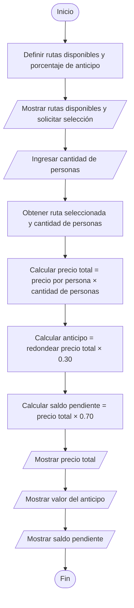

# 22 de oct de 2026

## MiniReto 1

### Definición del procedimiento de alquiler de una bicicleta

1. El cliente debe dar sus documentos de identidad

2. El tendero debe registrar en caso de que no haya ningún registro sobre los documentos y verificar información como: baneos, descuentos y condiciones dependiendo al perfil del cliente, si este está registrado.

3. El cliente debe decir la o las bicicletas que desea alquilar.

4. El tendero debe revisar el estado de la o las bicicletas que se piden para comprobar si es posible proceder con el alquiler.

5. Si todo está en orden para continuar el alquiler: 
    1. El tendero recibe el dinero que cuesta el alquiler y entrega la bicicleta.
6. Si hay algún problema: 
    1. El tendero deberá notificar las razones por las cuales no se puede proceder con el alquiler.
        
    2. Se le ofrece opciones al cliente similares y disponibles.

    3. Se le pregunta al cliente si está interesado en usar alguna otra opción.

    4. Si el cliente está interesado: 
        1. Se vuelve al paso número 3. 
    5. Si el cliente no está interesado:
        1. Se finaliza el proceso de alquiler.


### Características de un algoritmo

- Precisión: El algoritmo indica claramente qué debe hacer el cliente y qué debe hacer el tendero en cada paso. Por ejemplo, el cliente entrega sus documentos de identidad y el tendero verifica si está registrado y si tiene algún bloqueo que le impida alquilar una bicicleta.

- Finitud: El algoritmo tiene un inicio y un final. Por ejemplo, el proceso termina cuando el cliente recibe la bicicleta después de pagar el alquiler o cuando decide no alquilar ninguna de las opciones disponibles.

- Orden: Los pasos deben seguir una secuencia lógica para que el alquiler se realice correctamente. Por ejemplo, primero se verifican los documentos del cliente, después se selecciona la bicicleta y se revisa su estado, y finalmente se realiza el pago y se entrega la bicicleta si todo está en orden.

- Determinismo: Cada decisión depende de una condición específica y conduce a un resultado definido. Por ejemplo, si la bicicleta está disponible y en buen estado, se puede continuar con el alquiler. Si no lo está, se informa al cliente y se le ofrecen otras opciones.
    
- Efectividad: Cada paso se puede realizar de manera práctica y permite avanzar en el proceso. Por ejemplo, el tendero puede revisar el estado de la bicicleta para comprobar si funciona correctamente y determinar si puede alquilarse al cliente.

### Los cuatro pilares del pensamiento computacional

- Descomposición: Dividí el proceso de alquiler en tareas más pequeñas: verificar los documentos del cliente, consultar su registro, seleccionar las bicicletas, revisar su estado, recibir el pago y entregar la bicicleta. También incluí una alternativa para cuando no sea posible realizar el alquiler.

- Reconocimiento de patrones: Identifiqué que con cada cliente se repiten los mismos pasos: verificar su identidad, revisar sus condiciones, conocer qué bicicleta desea y comprobar si está disponible. Si hay algún problema, se le ofrecen otras opciones siguiendo el mismo procedimiento.

- Abstracción: Dejé por fuera detalles que no son necesarios para explicar el proceso principal, como el color de las bicicletas, sus marcas, los nombres de los clientes o el método específico de pago. Me concentré en la información necesaria para determinar si se puede realizar el alquiler.

- Algoritmo: Organicé los pasos en una secuencia lógica que comienza con la identificación del cliente y termina con la entrega de la bicicleta o la cancelación del proceso. Además, incluí decisiones para manejar los casos en los que una bicicleta no está disponible o el cliente no cumple con las condiciones del alquiler.

## MiniReto 2


**Una aclaración:** Nuestro asombroso Team Leader, Jesús, el único e inigualable, nos permitió usar JavaScript (Aunque yo en mi defecto utilizo TypeScript).

### Ejemplos del algoritmo

1. **Con una hora**:

    - Resultado esperado: `$10.000`

    - Resultado obtenido: 
        ```
        ✔ Seleccione el algoritmo de Rueda Libre Cotización Básica
        ✔ Escriba su nombre Luis
        ✔ Escriba el número de horas que desea usar la bicicleta 1
        Hola, Luis: tu alquiler de 1 hora cuesta $10.000
        ```

2. **Con tres horas**:

    - Resultado esperado: `$30.000`

    - Resultado obtenido: 
        ```
        ✔ Seleccione el algoritmo de Rueda Libre Cotización Básica
        ✔ Escriba su nombre Luis
        ✔ Escriba el número de horas que desea usar la bicicleta 3
        Hola, Luis: tu alquiler de 3 horas cuesta $30.000
        ```
3. **Con ocho horas**:

    - Resultado esperado: `$80.000`

    - Resultado obtenido: 
        ```
        ✔ Seleccione el algoritmo de Rueda Libre Cotización Básica
        ✔ Escriba su nombre Luis
        ✔ Escriba el número de horas que desea usar la bicicleta 8
        Hola, Luis: tu alquiler de 8 horas cuesta $80.000
        ```

### Casos excepcionales

#### Caso #1: cero horas

Al dar como argumento cero horas como valor, el alquiler, sería `PRICE_PER_HOUR * 0`, lo que en total, daría cero:

```
✔ Seleccione el algoritmo de Rueda Libre Cotización Básica
✔ Escriba su nombre Charlie Kirk
✔ Escriba el número de horas que desea usar la bicicleta 0
Hola, Charlie Kirk: tu alquiler de 0 horas cuesta $0
```

#### Caso #2: horas negativas

Con horas negativas, el precio total sería negativo. Básicamente la tienda tendría que pagarle al cliente:

```
✔ Seleccione el algoritmo de Rueda Libre Cotización Básica
✔ Escriba su nombre Tung Tung Tung Tung Sahur
✔ Escriba el número de horas que desea usar la bicicleta -67
Hola, Tung Tung Tung Tung Sahur: tu alquiler de -67 horas cuesta $-670.000
```

### Ruta del código del algoritmo

TypeScript: `src/algorithms/basic-cot.ts`.
PSeInt: `pseint/CotizacionBasica.psc`.

## MiniReto 3

### Prueba de escritorio para un grupo de 4 personas:

**Resultados hechos a mano:**

|Total a Pagar|Valor del anticipo|Saldo que queda pendiente|
|:---|:---|:---|
|$240.000|$72.000|$168.000|

**Resultados del programa**

```
✔ Seleccione el algoritmo de Rueda Libre Cotización Recorrido
✔ Seleccione el recorrido Sabores de Barrio, 18km, 3h, $60.000 (por persona)
✔ Escriba la cantidad de personas 4
El precio total del recorrido es: $240.000.
Para poder confirmar, debes pagar un anticipo del 30%, que sería: $72.000.
Luego tendrás un saldo pendiente de $168.000.
```

### Diagrama de flujo del algoritmo



### Ruta del código del algoritmo

TypeScript: `src/algorithms/cot-recorr.ts`
PSeInt: `pesint/CotizacionRecorrido.ts`


## MiniReto 4

### Cálculo del alquiler

Para el cálculo del alquiler, lo definiría así:

```
aporteVoluntario = 0 o 1
costoTotal = (sumaAlquilerBicis + precioRecorrido)
costoFinal = (costoTotal) + (costoTotal * 0.1 * aporteVoluntario)

costoPorIntegranteSinRedondear = costoFinal / clientes
costoPorIntegrante = ceil(costoPorIntegranteSinRedondear / 100) * 100
```

### Uso de trunc o redon

En mi caso utilicé `Math.ceil` que en PSeInt es `trunc`. La formula para calcular el valor redondeado hacia arriba a la centena es esta:

```
Math.ceil(valor / 100) * 100
```

**¿Por qué funciona?**

Porque `Math.ceil` lleva el valor a su entero más cercano (ej: `Math.ceil(1.5) = 1`)

### Casos de uso

#### 3 personas, 3 bicicletas por 2 horas y Río y Parques

**Resultado**

```
✔ Seleccione el algoritmo de Rueda Libre Asistente de Taquilla v0.1

✔ Escriba el número de bicicletas urbanas para alquilar. 3
✔ Escriba la cantidad de horas que durará el alquiler 2
✔ Seleccione la ruta que le gustaría tener Río y Parques, 12km, 2h,
 $45.000 por persona
✔ Escriba la cantidad de personas que participarán en el recorrido.
 3
✔ ¿Desea hacer un aporte voluntario del 10%? Sí
El costo del alquiler sería de $214.500
Gracias por tu aporte voluntario de $19.500 (el 10%).
Si se desean dividir la cuenta entre las 3 personas, el precio que cada uno debe pagar es de $71.500
```

#### 4 personas, 3 bicicletas por 3 horas y Sabores de Barrio

```
✔ Seleccione el algoritmo de Rueda Libre Asistente de Taquilla v0.1

✔ Escriba el número de bicicletas urbanas para alquilar. 3
✔ Escriba la cantidad de horas que durará el alquiler 3
✔ Seleccione la ruta que le gustaría tener Sabores de Barrio, 18km,
 3h, $60.000 por persona
✔ Escriba la cantidad de personas que participarán en el recorrido.
 4
✔ ¿Desea hacer un aporte voluntario del 10%? Sí
El costo del alquiler sería de $363.000
Gracias por tu aporte voluntario de $33.000 (el 10%).
Si se desean dividir la cuenta entre las 4 personas, el precio que cada uno debe pagar es de $90.800
```

#### Caso diseñado por mí: 67 personas, 6767 bicicletas, 676767 horas, ningún recorrido

```
✔ Seleccione el algoritmo de Rueda Libre Asistente de Taquilla v0.1

✔ Escriba el número de bicicletas urbanas para alquilar. 6767
✔ Escriba la cantidad de horas que durará el alquiler 676767
✔ Seleccione la ruta que le gustaría tener Ninguna
✔ Escriba la cantidad de personas que participarán en el recorrido.
 6767
✔ ¿Desea hacer un aporte voluntario del 10%? Sí
El costo del alquiler sería de $50.376.505.179.000
Gracias por tu aporte voluntario de $4.579.682.289.000 (el 10%).
Si se desean dividir la cuenta entre las 6767 personas, el precio que cada uno debe pagar es de $7.444.437.000
```